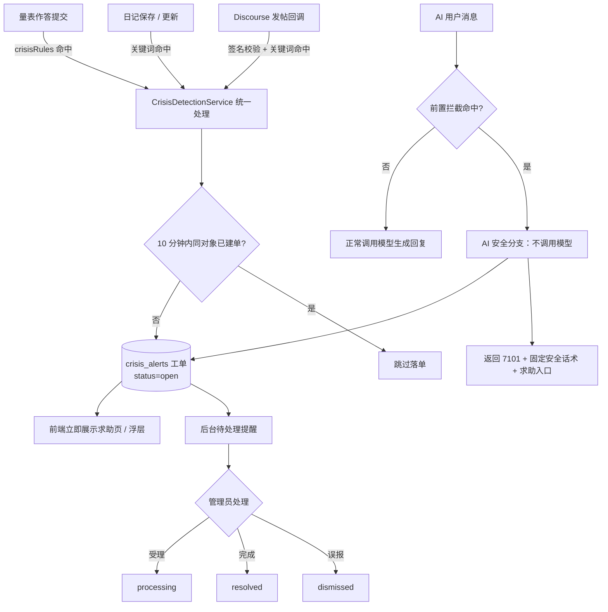

# 心灯（Light）危机干预流程规范 — 阶段 0.3

- 依据：[AGENTS.md](../AGENTS.md) 硬性规则 2（危机干预必须实现）；[er-design.md](./er-design.md) `crisis_alerts` / `crisis_keywords`；接口见 [api-spec.md](./api-spec.md) 第 3 节。
- 本文件是全站危机干预的**唯一权威流程契约**，阶段 1.4（危机触发服务）、2（日记）、3（社区回调）、5（AI 拦截）均以它为准。

## 1. 触发矩阵（四类来源，命中即触发）

| # | 来源 | 触发条件 | 检测时机 | 代码落点（阶段） |
|---|---|---|---|---|
| T1 | 量表作答 | **PHQ-9 第 9 题得分 ≥1**；通用化：作答命中该量表 `config_json` 中 `crisisRules` 的任一规则（规则由量表配置驱动，硬性规则 5） | 计分引擎得出总分与分级后、落库前 | 1.3/1.4 |
| T2 | 情绪日记 | 日记 `content`（保存时在服务端拿到明文）命中 `crisis_keywords` 任一启用关键词 | 日记创建 / 更新事务内 | 2 |
| T3 | 社区发帖 | Discourse 回调 payload（标题 + 正文）命中关键词 | 回调签名校验通过后 | 3 |
| T4 | AI 对话 | 用户消息在**调用模型前**的前置拦截中命中关键词 | 消息进入 AI 网关立即检测 | 5 |

- 关键词表：`crisis_keywords`（后台可增删改、`is_active` 启停）；初始词集在 1.4 以迁移种子提供（词集内容**需人工确认**，见 risk-list）。
- 匹配算法：0.3 期定为"启用关键词的包含匹配（大小写不敏感）"；后续如需升级（分词 / 正则）只改 `CrisisDetectionService` 单点实现。

## 2. 命中后的统一动作（任何来源都不例外）

1. **写入预警工单**：`crisis_alerts` 一条记录——`source`、关联外键（`scale_submission_id` / `diary_id` / `ai_session_id`）或 `external_ref`（社区）、`detail_json` 最小化快照（题目号 / 选项分 / 命中关键词；**不复制正文全文**）、`status='open'`。
2. **前端立即展示求助页 / 求助浮层**：数据来自 `GET /api/crisis/help`；文案与视觉遵守 CONVENTIONS 第 8 节（显眼但不惊吓，避免高饱和红色）。量表场景：结果页顶部展示求助入口 + 免责声明；日记 / AI 场景：保存 / 回复时弹出浮层。**求助页必须始终可从主要页面直达**（常驻入口，硬性规则 2 + 视觉约定）。
3. **通知后台**：工单 `status='open'` 出现在后台待处理列表（后台通过轮询 / 列表红点提醒，不另建管理员通知表）。
4. **AI 对话特有**：命中后**绝不调用模型**，直接返回 `code=7101` + 固定安全话术 + 求助入口（话术为配置项 `CRISIS_SAFE_REPLY`，占位文案上线前人工确认）；该消息 `ai_messages.is_crisis=1`，助手回复也以安全话术存档。

## 3. 防重与幂等

- **工单去重**：同一 `(source, user_id/external_ref, 关联对象 id)` 在 **10 分钟窗口内**只建一条工单；重复命中仍执行第 2 步的求助展示（用户侧永不静默），只是不再重复落单。
- 量表提交本身可重复（匿名用户可能反复作答）：每次命中均展示求助页，工单按上述窗口去重。
- 社区回调带 `topicId+postId` 天然幂等键；AI 会话内每条消息独立判断。

## 4. 工单状态机（后台处理）

```text
open ──(管理员受理)──▶ processing ──(处理完成)──▶ resolved
  └────────────(判定误报)──────────────▶ dismissed
```

- 处理接口：`POST /api/admin/crisis-alerts/{id}/handle`，`{ action, note }`；记录 `handled_by / handled_at / handle_note`。
- `resolved` / `dismissed` 为终态；终态工单不可再改（如需重开另建关联记录，阶段 2 后台实现时确认交互）。
- 列表默认按 `status=open` 置顶 + `created_at` 倒序。

## 5. 热线与安全话术配置（硬性规则 2：一律可配置、不写死号码）

| 配置项 | 形式 | 默认值（占位） | 说明 |
|---|---|---|---|
| `CRISIS_HOTLINES` | 环境变量，JSON 数组：`[{"name":"…","number":"…","note":"…"}]` | `[{"name":"心理援助热线（占位）","number":"0-000-000000","note":"上线前人工核实"}]` | 求助页与所有危机响应展示；**上线前必须人工核实并替换** |
| `CRISIS_SAFE_REPLY` | 环境变量 / 配置 | 固定安全话术占位（表明关心、不评判、引导求助入口与热线） | AI 命中危机时的唯一回复来源 |
| `CRISIS_HELP_PATH` | 配置 | `/crisis-help` | 前端求助页路由 |

## 6. 关键词缓存策略

- `CrisisDetectionService` 启动时加载全部 `is_active=1` 关键词至内存单例；后台增删改后通过 `BackgroundService` 定时（30s）刷新 + 手动"立即生效"接口（阶段 1）。
- 不把关键词明文写入日志；命中记录只存命中的关键词本身（detail_json）。

## 7. 端到端流程图



渲染版见会话内可视化（本文件第 7 节源码为准）。

## 8. 验收清单（对应 PROJECT_BRIEF 各阶段验收）

| 阶段 | 验收项 | 用例 |
|---|---|---|
| 1 | PHQ-9 第 9 题 ≥1 → 求助页 + 工单 | web-gui-tester 实测作答 |
| 2 | 日记写命中词 → 浮层 + 工单；DB 中正文为密文 | GUI + 直查数据库 |
| 3 | 社区回调命中 → 工单（external_ref 正确） | 模拟回调（有效 / 无效签名） |
| 5 | AI 输入自伤语句 → 不调用模型、7101 + 安全话术 | GUI + 网关日志确认无模型调用 |
| 全程 | 同对象 10 分钟内重复命中只建一单；求助页常驻入口可见 | 自动化 + GUI |
