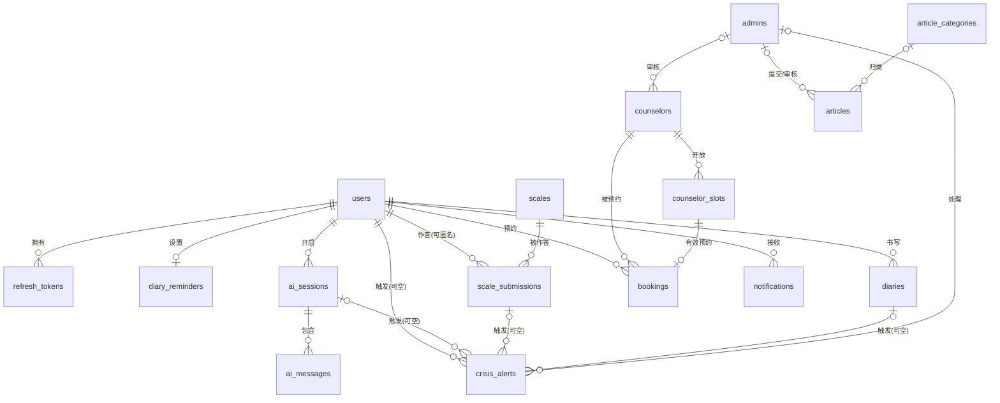

# 心灯（Light）ER 设计 — 阶段 0.2

- 对应脚本：`/backend/db/migrations/0001_init.sql`
- 约定依据：[CONVENTIONS.md](./CONVENTIONS.md) 第 4.2 节（数据库规范）
- 状态：**待用户确认**。确认后此文件即为表结构契约，后续实现以它为准；如需改字段先改这里并说明理由。

## 1. 设计原则

1. **合规优先**：敏感内容（日记正文、量表答案、AI 消息）一律在应用层 AES-GCM 加密后入库，存储格式为 `nonce(12B) + ciphertext + tag(16B)` 拼接的二进制；数据库中不存在对应明文列。明文仅保留展示与统计所必需的最小字段（总分、分级代码、心情分）。
2. **数据最小化**：不设置与功能无关的字段（不采集生日、住址等；咨询师性别为对外展示信息，由咨询师自愿提供）。
3. **时间**：所有时间列 `DATETIME(3)`，统一存 UTC（部署配置保证会话时区为 UTC），前端负责本地化。
4. **主键与对外标识**：主键 `id BIGINT UNSIGNED AUTO_INCREMENT`；`users` 与 `scale_submissions` 另有 `public_id CHAR(36)`（应用层生成 GUIDv7），凡需在 URL / 外部系统（如 Discourse）中暴露的引用一律用 `public_id`，防枚举、不泄露内部序号。
5. **迁移幂等**：全部使用 `CREATE TABLE IF NOT EXISTS`，脚本可重复执行。
6. **外键显式声明**：默认 `ON DELETE RESTRICT`——删除必须走应用层显式流程，保证合规可审计；日志型/从属型数据（通知、提醒、会话消息、时段）随主实体 `CASCADE` 或 `SET NULL`。
7. **危机干预贯穿全站**：`crisis_alerts`（预警工单）支持四种来源：量表作答、日记、社区发帖（Discourse 回调）、AI 对话。

## 2. 实体总览（17 张表）

| # | 表名 | 用途 | 敏感字段（密文） | 所属阶段 |
|---|---|---|---|---|
| 1 | `users` | 前台用户（手机/邮箱 + 密码或验证码） | — | 2 |
| 2 | `admins` | 后台管理员（独立凭据，与前台分离） | — | 2 |
| 3 | `refresh_tokens` | 刷新令牌（存 SHA-256 哈希，不存原文） | — | 2 |
| 4 | `diary_reminders` | 日记提醒设置（每用户一条） | — | 2 |
| 5 | `scales` | 量表定义：题目/选项/计分/分级/预警规则全部在 `config_json` | — | 1 |
| 6 | `scale_submissions` | 作答记录（支持匿名，`user_id` 可空） | `answers_cipher` | 1 |
| 7 | `diaries` | 情绪日记（每用户每天一条） | `content_cipher` | 2 |
| 8 | `crisis_keywords` | 危机关键词配置（日记/社区/AI 命中触发预警） | — | 1 |
| 9 | `crisis_alerts` | 预警工单（危机干预核心表） | — | 1 |
| 10 | `ai_sessions` | AI 陪伴会话 | — | 5 |
| 11 | `ai_messages` | AI 陪伴消息 | `content_cipher` | 5 |
| 12 | `counselors` | 咨询师档案（含资质字段与审核状态） | — | 4 |
| 13 | `counselor_slots` | 可预约时段 | — | 4 |
| 14 | `bookings` | 预约（DB 层防超卖） | — | 4 |
| 15 | `article_categories` | 科普文章分类 | — | 3 |
| 16 | `articles` | 科普文章（审核发布，含来源/审核人/更新时间） | — | 3 |
| 17 | `notifications` | 站内通知 | — | 4 |

## 3. 实体关系

| 关系 | 说明 |
|---|---|
| `users 1—N refresh_tokens` | 一个用户多个活跃设备/会话令牌 |
| `users 1—1 diary_reminders` | 每用户一条提醒设置 |
| `users 1—N scale_submissions` | `user_id` 可空 = 匿名作答 |
| `users 1—N diaries` | 软删除（`deleted_at`） |
| `users 1—N ai_sessions 1—N ai_messages` | 会话内消息按 `id` 排序 |
| `users 1—N bookings` / `users 1—N notifications` / `users 1—N crisis_alerts` | `crisis_alerts.user_id` 可空（社区匿名场景） |
| `scales 1—N scale_submissions` | 冗余 `scale_code` 便于统计，避免联表 |
| `scale_submissions / diaries / ai_sessions —0..1 crisis_alerts` | 预警工单通过可空外键 + `source` 字段关联来源，社区来源用 `external_ref` 存 Discourse 引用 |
| `admins 1—N crisis_alerts(处理) / counselors(审核) / articles(提交与审核)` | 后台操作留痕 |
| `article_categories 1—N articles` | 分类可空 |
| `counselors 1—N counselor_slots` | 时段唯一键 `(counselor_id, start_at)` |
| `counselor_slots 1—0..1 bookings(有效)` | 见防超卖设计 |

Mermaid 源码（渲染版见 ER 图页面）：

## 4. 关键设计决策

1. **匿名作答**：`scale_submissions.user_id` 可空，匿名结果通过 `public_id` 取回；登录后作答则关联 `user_id`。
2. **防超卖（DB 层兜底）**：`bookings.active_slot_key` 为生成列——`status='booked'` 时等于 `slot_id`，否则为 `NULL`；其上有唯一索引 `uk_bookings_active_slot`。MySQL 唯一索引允许多个 `NULL`，因此**同一时段最多只有一条有效预约**由数据库保证；应用层再配合时段行原子更新（`UPDATE counselor_slots SET status='booked' WHERE id=? AND status='available'`）。阶段 4 用并发测试验证。
3. **预警快照最小化**：`crisis_alerts.detail_json` 只存触发要素（题目号/选项分/命中关键词/来源引用），**不复制日记正文或消息全文**。
4. **密文字段长度**：量表答案 `VARBINARY(4096)`；日记正文与 AI 消息 `MEDIUMBLOB`；应用层限制输入长度确保密文不溢出。
5. **软删除与唯一键**：`diaries` 唯一键 `(user_id, entry_date)`；软删除的日记不释放该日期——同日期重新记录走"恢复/覆盖"逻辑而非新建，避免绕过唯一键（应用层实现，见接口设计）。
6. **量表全配置化**（硬性规则 5）：`scales.config_json` 存题目、选项、计分、分级、预警规则；`CHECK (JSON_VALID(...))` 保证合法 JSON。新增量表 = 插入一行配置，不改代码。
7. **分级结果只存代码与文案**：`level_code`（如 `moderate`）+ `level_label`（展示文案，不含诊断表述），供趋势与统计使用；明细答案始终密文。
8. **令牌安全**：`refresh_tokens.token_hash` 存 SHA-256 哈希；令牌轮换/撤销记 `revoked_at`。
9. **注销匿名化**：`users.status='anonymized'` + `deleted_at`；手机号/邮箱/昵称/头像/密码哈希清空。详见第 5 节。
10. **时间默认值**：`created_at DEFAULT CURRENT_TIMESTAMP(3)`，`updated_at` 加 `ON UPDATE CURRENT_TIMESTAMP(3)`；纯日志型表（`ai_messages`）只有 `created_at`。

## 5. 账号注销与数据删除策略（阶段 2 实现）

- **默认匿名化**：清除 PII 列（手机/邮箱/昵称/头像/密码），保留密文的日记/答案/AI 消息与否 → **待产品确认**（0.3 写入 `/docs/TODO.md`）。
- **彻底删除**：按外键依赖顺序显式删除，提供"导出我的数据"功能先行（硬性规则 4）。
- 技术上受 `ON DELETE RESTRICT` 约束，两条路径都由应用层在事务中显式执行，保证可审计。

## 6. 验证计划与环境说明

- 本机现有 MySQL 为 **5.7.44**（Windows 服务），不满足项目要求的 MySQL 8。
- 步骤 0.2 的验证方式：
  1. 用 5.7 二进制在**独立 datadir + 端口 3307** 起临时实例（不触碰现有服务与数据），把脚本中 `utf8mb4_0900_ai_ci` 临时替换为 `utf8mb4_unicode_ci` 后执行两遍，验证：建表成功、17 张表齐全、关键索引/外键/生成列生效、**幂等可重复执行**；
  2. 用 sqlfluff（MySQL 方言）对**原始脚本**做静态语法解析；
  3. MySQL 8 专属特性（`utf8mb4_0900_ai_ci`、强制 `CHECK` 约束）在 1.2 迁移工具落地时对真实 MySQL 8 复验。
- **环境前提（需安排）**：阶段 1 开发前需要可用的 MySQL 8（建议 Docker Desktop）或本地安装 MySQL 8；本机 Docker 当前不可用。

## 7. 种子数据说明

`0001_init.sql` 只含表结构。种子数据（PHQ-9 / GAD-7 / SDS 的 JSON 配置、初始管理员账号、危机关键词初始集）在阶段 1.2 / 1.3 以独立迁移或配置装载方式提供，不混入建表脚本。
